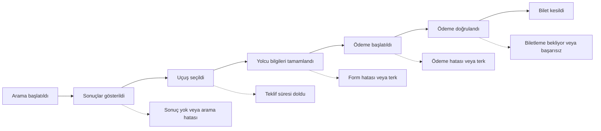

# 5. Analitik ve başarı ölçümü

## Araçlar ve sorumlulukları

- **GA4:** Trafik kaynağı, kampanya, açılış sayfası ve web ölçümleri.
- **Google Tag Manager (GTM):** Web etiketlerinin yönetimi. Yayın yetkileri sınırlı olmalı; değişiklikler incelenip sürüm notuyla yayımlanmalı.
- **PostHog:** Ürün akışı, dönüşüm hunisi, kullanıcı grupları ve davranış incelemesi. Kayıt ve deney özellikleri yalnızca izin, maskeleme ve mevcut kurulum uygun olduğunda kullanılmalı.
- **Hata izleme:** Mevcut araç varsa onu kullanın; yoksa Sentry benzeri bir araç değerlendirin. İstek gövdeleri ve kişisel bilgiler varsayılan olarak maskelenmeli.
- **Veri ambarı ve raporlama:** İlk sürüm için zorunlu değil. İhtiyaç doğrulanırsa 4–6. ayda mevcut kurumsal raporlama aracı veya BigQuery ve Looker Studio değerlendirilebilir.

| İhtiyaç | Araç / kaynak | Kullanım |
|---|---|---|
| Trafik ve edinim | GA4 | Kanal, kampanya ve açılış sayfası |
| Web etiketleri | GTM | Etiketlerin kontrollü yönetimi |
| Ürün davranışı | PostHog | Huni, kullanıcı grubu ve akış analizi |
| Teknik hata | Mevcut hata izleme aracı | Arayüz hatası, sürüm ve hata gruplama |
| Organik arama | Search Console | Tıklama, gösterim ve indeksleme sorunları |
| Ticari işlem doğruluğu | Sunucu sipariş/biletleme kayıtları | Kesilmiş bilet sayısı ve finansal mutabakat |

## Dönüşüm hunisi

## Huni metrikleri

| Adım | Temel ölçüt | Teşhis ölçütleri |
|---|---|---|
| Arama | Arama oturumu, aramadan satışa dönüşüm | Geçersiz arama, rota ve tarih kırılımı |
| Sonuç | Sonuç gösterme ve sonuçsuz arama oranı | API p50/p95/p99, zaman aşımı, sonuç sayısı |
| Uçuş seçimi | Sonuçtan teklif seçimine geçiş | Filtre kullanımı, sıralama, teklif süresi |
| Yolcu | Form tamamlama oranı | Alan bazlı hata sayısı; kişisel bilgi kaydetmeden |
| Ödeme | Başarı ve terk oranı | Hata türü, fiyat farkı, yeniden onay |
| Biletleme | Bilet kesilme oranı ve süresi | Bekleyen/başarısız işlem, yeniden deneme, mutabakat farkı |
| Satış sonrası | İptal ve destek başvurusu | İptal nedeni ve fiyat şikâyeti |

## Olay sözlüğü

Tam olay listesi [event-dictionary.csv](event-dictionary.csv) dosyasındadır. Olay adları küçük harf ve alt çizgiyle yazılır. Uygun olduğunda olaylar olay kimliği, zaman damgası, oturum/arama/sipariş için rastgele tanımlayıcı, tedarikçi ve ortam bilgisiyle ilişkilendirilir. Her olayda her alanın bulunması gerekmez; yalnızca ihtiyaç duyulan veri toplanır.

| Olay | Tetikleyici | Örnek özellikler |
|---|---|---|
| flight_search_submitted | Arama isteği gönderildi | Kalkış/varış, tarih, yolcu sayısı |
| flight_search_results_viewed | Kullanılabilir sonuçlar gösterildi | Sonuç sayısı, arama süresi, tedarikçi |
| flight_search_empty | Kullanılabilir sonuç bulunmadı | Hata/boş sonuç kategorisi |
| flight_filter_applied | Filtre uygulandı | Filtre türü, seçilen değer sayısı |
| flight_offer_selected | Teklif seçildi | Rastgele teklif kimliği, toplam, para birimi |
| price_change_detected | Yeniden doğrulamada fiyat değişti | Eski/yeni toplam, fark, para birimi |
| price_change_accepted | Kullanıcı yeni fiyatı kabul etti | Fark, para birimi |
| payment_started | Sunucu ödeme işlemini başlattı | Rastgele sipariş kimliği, tutar, para birimi |
| payment_succeeded | Ödeme bildirimi sunucuda doğrulandı | Rastgele sipariş kimliği, tutar, para birimi |
| ticket_issued | Bilet kesimi doğrulandı | Rastgele sipariş kimliği, bilet sayısı |
| ticketing_failed | Biletleme başarısızlığı doğrulandı | Hata kategorisi, tedarikçi |

## Ölçüm kuralları

- Ödeme ve bilet kesimi olayları, mümkün olduğunda tarayıcı sayfasından değil sunucu tarafındaki doğrulanmış işlemden üretilir.
- Para birimi ISO 4217 standardında, zaman damgaları tutarlı biçimde saklanır.
- Kart numarası, güvenlik kodu, yolcu adı, pasaport/kimlik numarası, e-posta ve telefon analitik olaylarına yazılmaz.
- Sipariş ve teklif tanımlayıcıları kişiyi tanımlamayan, tahmin edilemeyen değerler olmalıdır.
- Yinelenen bildirimler ve sayfa yenilemeleri satış sayısını artırmamalıdır.
- API yanıt süresi ile sonuçların kullanıcı ekranında kullanılabilir hâle gelme süresi ayrı ölçülür.
- GA4 ve PostHog aynı olay sözlüğünü temel alsa da izin, oturum ve ilişkilendirme yöntemleri farklı olabileceğinden sayılar bire bir eşleşmeyebilir. Kesilmiş bilet sayısı sunucu kayıtlarıyla karşılaştırılır.

## İzin ve veri gizliliği

- Zorunlu olmayan analitik, reklam ve oturum kaydı araçlarının kullanımı şirketin hukuk/KVKK değerlendirmesi ve geçerli izin mekanizmasına uygun olmalıdır.
- İzin gerektiren etiketler izin verilmeden çalışmamalı; bu davranış teknik olarak test edilmelidir.
- İzin durumu bir olay alanı olabilir, ancak tek başına izin yerine geçmez.
- Oturum kayıtlarında form, yolcu ve ödeme alanları maskelenmeli; erişim ve saklama süresi sınırlandırılmalıdır.
- Ticari ileti izinleri (İYS) ile analitik çerez tercihleri ayrı yönetilir.
- İzin tercihleri nedeniyle ölçümde oluşan eksiklik raporlarda belirtilir. Kullanıcılar arasında kimlik eşleştirmesi hukuk ve izin kontrolü olmadan yapılmaz.
