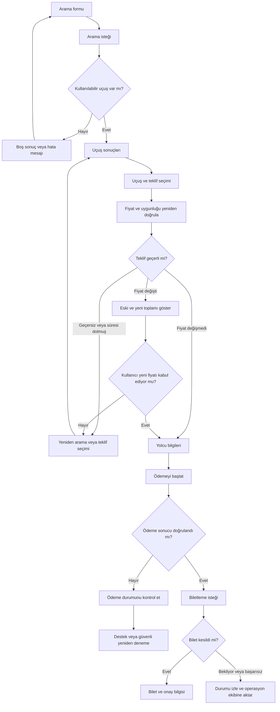
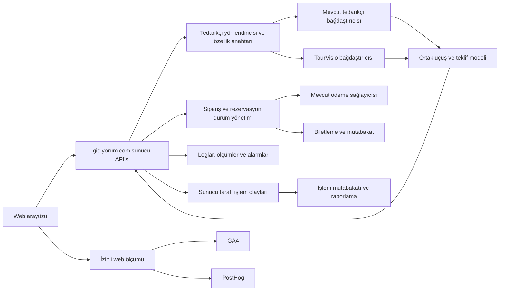
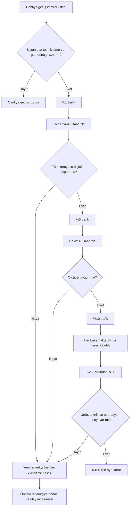
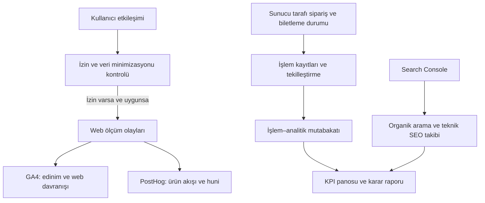

# Akış ve mimari diyagramları

Bu diyagramlar ürün akışını ve karar kapılarını özetler. Teknik ayrıntıların kaynağı API sözleşmesi ve ilgili Epic dokümanlarıdır.

## 1. Aramadan biletlemeye kullanıcı akışı

## 2. Önerilen teknik sınırlar

Not: Analitik araçlarına veri gönderimi izin ve veri minimizasyonu kurallarına uymalıdır. Yolcu, ödeme kartı ve diğer hassas bilgiler analitik olaylarına veya loglara yazılmaz.

## 3. Kademeli canlıya geçiş ve geri dönüş

Trafik yüzdesi tek başına ilerleme ölçütü değildir. Fiyat tutarlılığı, ödeme ve biletleme başarısı, hata oranı ve SEO sağlığı kabul aralığında olmalıdır. Her basamakta karar, kanıt ve sorumlu kaydedilir.

## 4. Ölçüm ve raporlama akışı

GA4/PostHog kullanıcı davranışını, sunucu kayıtları ise doğrulanmış ticari işlemleri ölçer. Sayılar arasındaki farklar; izin tercihleri, olay kaybı, yinelenen bildirimler ve ölçüm tanımları dikkate alınarak açıklanmalıdır.
