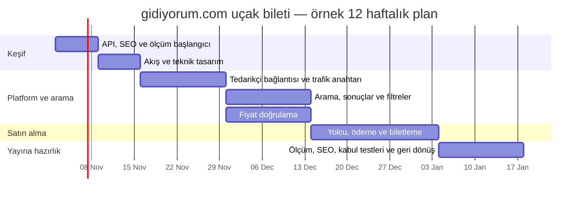

# 2. İş paketleri, öncelikler ve 12 haftalık yol haritası

## Önceliklendirme

İlk hedef, 12 hafta içinde arama–fiyat doğrulama–ödeme–biletleme akışını güvenli biçimde canlıya almaktır. Bu nedenle aşağıdaki işler zorunludur: tedarikçi bağlantısı, doğru fiyat, ödeme ve biletleme, geri dönüş planı, SEO sürekliliği, ölçüm ve operasyon hazırlığı. Kişiselleştirme ve ileri deneyler ilk canlı sürümden sonraya bırakılabilir.

İlk sürümde MoSCoW yöntemiyle **zorunlu / önemli / olursa iyi olur / kapsam dışı** ayrımı yapılır. İlk sürüm sonrası iyileştirmeler, erişim, beklenen etki, güven düzeyi ve geliştirme maliyeti dikkate alınarak önceliklendirilir.

## İş paketleri

| ID | İş paketi | Öncelikli çıktı | Sorumlu lider |
|---|---|---|---|
| E1 | TourVisio bağlantısı | Ortak tedarikçi arayüzü ve doğrulanmış API sözleşmesi | Backend 1 |
| E2 | Arama ve sonuçlar | Arama, filtre, sıralama ve hata durumları | Arayüz geliştiricisi |
| E3 | Fiyat doğruluğu | Ödeme öncesi fiyat/uygunluk kontrolü ve kullanıcı onayı | Backend 1 + arayüz |
| E4 | Yolcu, ödeme ve biletleme | İşlem durumları, yinelenen işlem koruması ve mutabakat | Backend 1 + Backend 2 |
| E5 | SEO sürekliliği | Adreslerin korunması ve teknik SEO denetimi | Pazarlama/SEO + arayüz |
| E6 | Trafik yönlendirme ve izleme | Aşamalı trafik, alarm ve geri dönüş | Backend 2 + teknik lider |
| E7 | Analitik ve ölçüm | Olay sözlüğü, başarı ölçütleri ve panolar | Ürün + backend/arayüz + QA |
| E8 | Operasyon ve lansman hazırlığı | Destek yönergeleri, eğitim ve canlıya geçiş kontrolü | Ürün + operasyon |
| E9 | Dönüşüm iyileştirmeleri | Ölçülebilir iyileştirme denemeleri | Ürün + arayüz + analitik |

Her iş paketinin kapsamı, kabul ölçütleri ve bağımlılıkları [ayrı iş paketi belgelerinde](./epics/README.md) bulunur. Lider rol, tüm işi tek başına yapacağı anlamına gelmez; teslimat için ilgili ekip üyeleriyle birlikte çalışır.

## Bağımlılık sırası

1. **Keşif:** API sözleşmesi (E1), SEO başlangıç ölçümü (E5), başarı ölçütleri ve olay sözlüğü (E7).
2. **Arama temeli:** Ortak tedarikçi modeli (E1) ardından arama ve sonuç deneyimi (E2).
3. **Güvenli satın alma:** Fiyat doğrulama (E3), ardından yolcu, ödeme ve biletleme (E4).
4. **Canlıya çıkış hazırlığı:** Trafik yönlendirme ve geri dönüş (E6), ölçüm (E7), operasyon ve destek hazırlığı (E8).
5. **İyileştirme:** E9 yalnızca kritik ölçüm ve güvenlik kontrolleri çalıştığında başlatılır.

Ekipler paralel çalışabilir; ancak bağımlılık doğrulanmadan ilgili akış canlıya alınmaz.

## İlk iş listesi

1. TourVisio test ortamı ve API sözleşmesini doğrulama.
2. Mevcut arama hunisi, biletleme ve SEO için başlangıç ölçümü çıkarma.
3. Tedarikçi bağlantısı ve trafik yönlendirme temelini kurma.
4. Arama sonuçlarını ortak biçime dönüştürme; hata ve boş sonuç durumlarını ele alma.
5. Fiyat ve uygunluğu ödeme öncesinde yeniden doğrulama.
6. Yolcu–ödeme–biletleme durumlarını ve yinelenen istek korumasını uygulama.
7. Ölçüm olaylarını, panoları ve kalite kontrollerini doğrulama.
8. SEO regresyonu, operasyon yönergeleri ve geri dönüş provası.
9. Küçük trafik diliminde pilot ve karar kapıları.
10. Ölçütler uygunsa kademeli trafik artırımı.

## 12 haftalık plan

| Hafta | Odak | Ana çıktı | Geçiş koşulu |
|---|---|---|---|
| 1 | Keşif ve riskler | API/SEO/ölçüm başlangıç durumu, sorumlular ve risk kaydı | Kritik sorular cevaplanmış veya sahibi atanmış |
| 2 | Tasarım ve planlama | Akışlar, API sözleşmesi, test ve ölçüm planı | İşler tahmin edilebilir; kritik kararlar kayıtlı |
| 3–4 | Tedarikçi bağlantısı | Ortak veri modeli, bağlantı ve hata yönetimi | Test ortamında arama ve hata senaryoları geçer |
| 5–6 | Arama ve fiyat | Sonuç listesi, filtreler, fiyat doğrulama | Fiyat değişimi ve süresi dolan teklif senaryoları geçer |
| 7–8 | Satın alma | Yolcu, ödeme, biletleme ve işlem kurtarma | Test ortamında uçtan uca satın alma ve hata kurtarma geçer |
| 9 | Ölçüm ve SEO | Olay doğrulama, panolar ve adres taraması | Kritik olaylar doğru; kritik SEO hatası yok |
| 10 | Kullanıcı kabulü ve operasyon | Kabul testleri, eğitim, işletim yönergeleri ve geri dönüş provası | Kritik hata yok; geri dönüş kanıtlandı |
| 11 | Canlı pilot | %1, ardından uygunsa %5 trafik | En az 48 saat boyunca koruyucu ölçütler uygun |
| 12 | Kontrollü büyütme | Uygunsa %10 ve %25 trafik | Her artış ayrı kararla onaylanır; %50 ve %100 sonraki kararlardır |

## Sonraki dönem

- **13–16. haftalar:** Ölçütler uygunsa %50 ve ardından %100'e geçiş; her basamakta 48–72 saat izleme.
- **4. ay:** Uçuş kapsamı, arama süresi ve fiyat değişikliği oranındaki açıkların azaltılması.
- **5. ay:** Yeterli veri varsa kontrollü deneyler; mobil akış ve ödeme terk analizleri.
- **6. ay:** Başarı ölçütlerini gözden geçirme ve sonraki ürün yatırım planı.

## Zaman çizelgesi

Tarihler örnek planlamadır; proje başlangıcında doğrulanmalıdır. 12. haftanın hedefi %100 trafik değil, güvenli ilk canlı sürüm ve ölçüme dayalı genişleme kararıdır.
