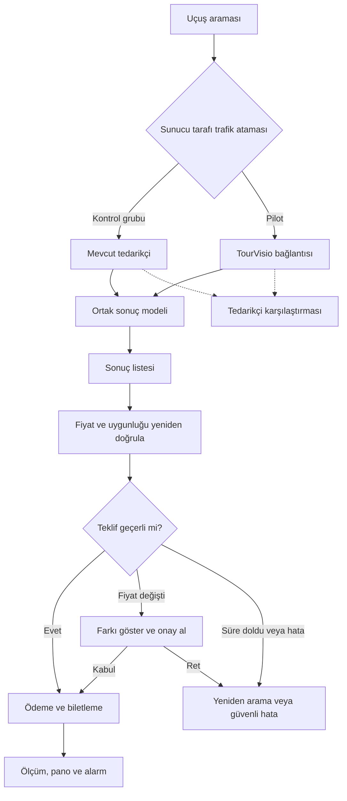

# 4. Tedarikçi geçişi, izleme ve risk yönetimi

## Geçiş ilkeleri

- Tedarikçi seçimi sunucu tarafında yapılır; gizli anahtarlar tarayıcıya gönderilmez.
- Yeni tedarikçi için trafik anahtarı varsayılan olarak kapalıdır; sorun halinde yeni aramalar eski tedarikçiye yönlendirilir.
- Arama oturumu ve açık sipariş boyunca aynı tedarikçi korunur. İşlem ortasında tedarikçi değiştirilmez.
- Trafik grupları oturum bazında tutarlı atanır.
- Aynı satın alma işlemi iki tedarikçide birden oluşturulmaz.
- Gölge karşılaştırma yalnızca sözleşme ve hız sınırları izin veriyorsa, satın alma oluşturmayan arama istekleriyle yapılır. Aksi durumda sınırlı ve elle doğrulanan rota örnekleri kullanılır.

## Trafiği aşamalı artırma

| Aşama | TourVisio trafik payı | Asgari gözlem | Karar koşulu |
|---|---:|---|---|
| Test ve kullanıcı kabulü | Canlı trafik yok | Tüm kritik testler bitene kadar | Uçtan uca satın alma ve geri dönüş provası başarılı |
| İlk pilot | %1 | 24–48 saat | Kritik hata yok; fiyat ve biletleme ölçütleri uygun |
| Pilot genişletme | %5 | En az 48 saat | Sonuç kapsamı, arama süresi ve destek başvuruları kabul aralığında |
| 1. genişletme | %10 | 48–72 saat | Önemli rota ve cihaz gruplarında kötüleşme yok |
| 2. genişletme | %25 | 48–72 saat | Fiyat farkı ve finansal mutabakat uygun |
| 3. genişletme | %50 | En az 72 saat | Tedarikçi kapasitesi ve hizmet seviyesi doğrulanmış |
| Tam geçiş | %100 | İlk hafta yoğun izleme | Ürün, teknik ekip ve operasyon onayı |

Her aşamada artış yalnızca yeni aramalara uygulanır. Açık siparişler kendi işlem akışında tamamlanır. Her kararın ölçüm kanıtı, sorumlusu ve tarihi kaydedilir.

## Tedarikçi karşılaştırması

| Boyut | Karşılaştırma yöntemi | Kırılımlar ve dikkat noktaları |
|---|---|---|
| Fiyat | Aynı rota, tarih, yolcu, para birimi, bagaj ve zorunlu ücret kapsamındaki toplam | Yalnızca aynı koşullardaki ve satın alınabilir teklifler karşılaştırılır |
| Uçuş kapsamı | Kullanılabilir benzersiz uçuş/seyahat seçeneği sayısı | Rota, tarih, havayolu; tek arama kesin sonuç sayılmaz |
| Satış dönüşümü | Arama oturumundan kesilmiş bilete geçiş | Cihaz, kanal, rota ve trafik karması |
| Hız | API yanıt süresi p50/p95/p99 ve zaman aşımı | Arayüzde sonuçların görünme süresi ayrı ölçülür |
| Fiyat tutarlılığı | Liste fiyatı ile ödeme öncesi doğrulanan toplam arasındaki fark | Fiyat değişimi uyarısı ve kullanıcı onayı ayrıca izlenir |
| Operasyon | Hata türü, biletleme başarısı/gecikmesi, destek başvurusu | Finansal mutabakat koruyucu ölçüttür |

## Geri dönüş ölçütleri

Aşağıdaki eşiklerden biri gerçekleşirse alarm oluşturulur ve sorumlu ekip inceleme başlatır. Güvenlik veya finansal riskte trafik anahtarı derhal eski tedarikçiye döndürülür.

- Biletleme başarı oranı 30 dakikalık dönemde baz çizgiye göre 5 yüzde puan veya daha fazla düşerse.
- Çift tahsilat/rezervasyon şüphesi, biletlenmeyen tahsilat veya veri sızıntısı oluşursa.
- Fiyat değişikliği oranı 30 dakika boyunca %5'i aşarsa ya da zorunlu ücretlerin toplam fiyata dahil olmadığı görülürse.
- Arama p95 süresi 10 saniyeyi aşarsa veya zaman aşımı oranı 15 dakika boyunca %10'un üstünde kalırsa.
- Sonuçsuz arama oranı karşılaştırma grubuna göre 5 yüzde puandan fazla kötüleşirse veya belirli bir havayolu/rota sistematik olarak kaybolursa.
- Kritik SEO adreslerinde 404 artışı veya geçişle ilişkili belirgin organik trafik kaybı görülürse.
- Tedarikçi kapasite sorunu veya kritik kesinti bildirirse.

Bu eşikler başlangıç değerleridir; ilk hafta baz çizgiye göre onaylanmalıdır. Geri dönüş yeni aramaları eski tedarikçiye yönlendirir; açık işlemler izlenmeye devam eder. Ardından olay kaydı ve neden analizi yapılır.

## Başlıca riskler

| Risk | Erken sinyal | Önlem | Sorumlu |
|---|---|---|---|
| Fiyat/teklif uyuşmazlığı | Yeniden doğrulama farkı, terk, şikâyet | Ödeme öncesi doğrulama, süre yönetimi ve açık onay | Backend + SAN TSG |
| API gecikmesi/kesintisi | p95, zaman aşımı, 429/5xx | Kontrollü yeniden deneme, devre kesici, kapasite testi ve geri dönüş | Backend |
| Uçuş kapsamı eksiği | Rota/havayolu sonuç farkı | Kritik rota listesi ve tedarikçi eskalasyonu | Ürün + backend |
| SEO kaybı | 404, canonical ve organik tıklama değişimi | Adresleri koruma, yayın öncesi tarama ve izleme | Arayüz + SEO |
| Ödeme var, bilet yok | Bekleyen işlem, yinelenen bildirim | Tekilleştirme, işlem durum yönetimi, mutabakat ve kurtarma yönergesi | Backend + QA + finans |

## Geçiş akışı

